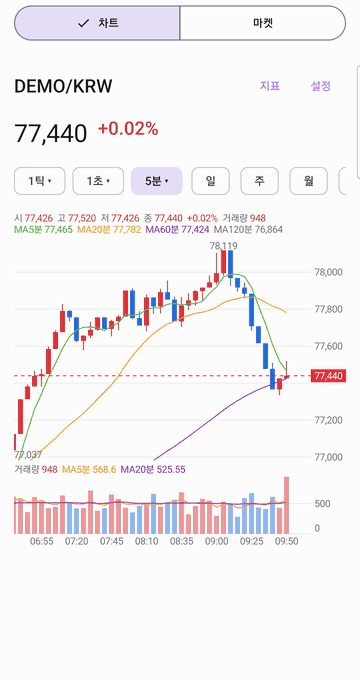
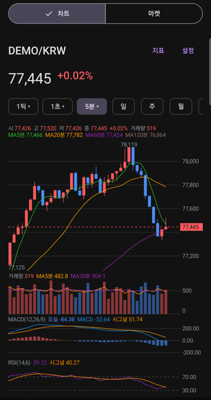
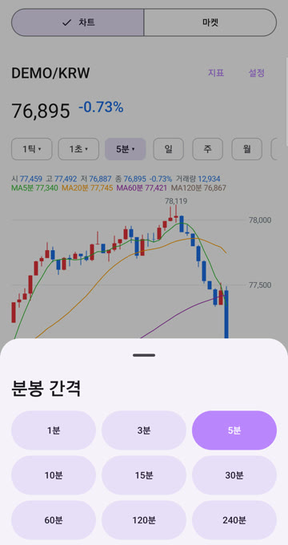
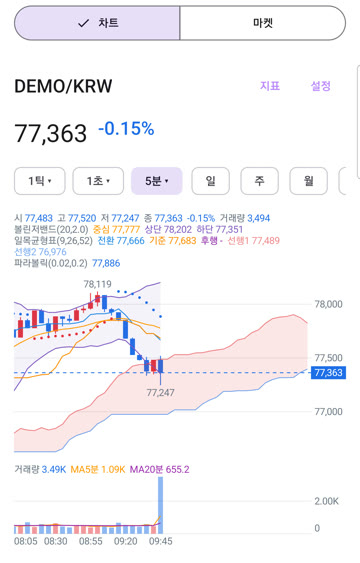
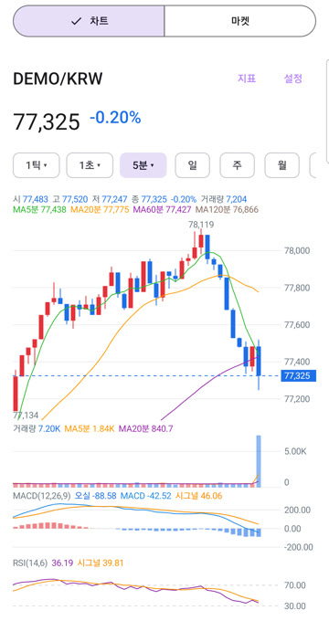
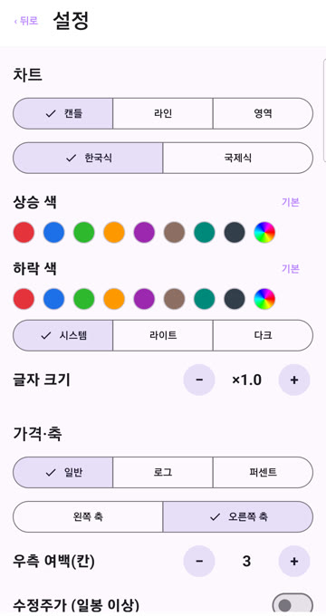
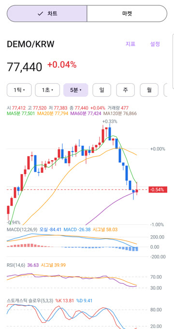
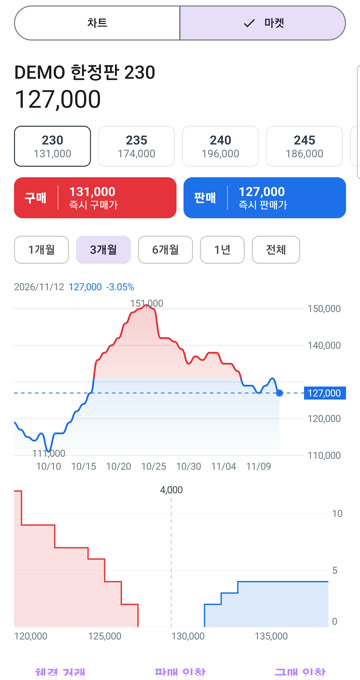
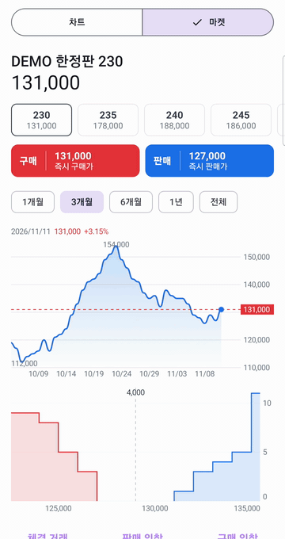

# LineChart

<p align="center">
  <a href="https://search.maven.org/artifact/io.github.teddko/linechart"></a>
  <a href="https://search.maven.org/artifact/io.github.teddko/linechart-orderbook"></a>
  <a href="https://android-arsenal.com/api?level=23"></a>
  <a href="https://opensource.org/licenses/Apache-2.0"></a>
</p>

Jetpack Compose trading chart with candles, 30 indicators, multi-pane layout, live updates and marketplace components, plus a pure Kotlin order book engine.

<p align="center">
  
</p>

## Features

* Candle, Line and Area series (`ChartType`) with volume, a last price line and visible-range high/low markers
* 9 overlay and 21 pane indicators, multi-pane layout with per-pane axes, legends and crosshair tags
* Pan with fling, pinch zoom, long-press crosshair, long-press pane resize; vertical drags go to the parent scroll
* Real-time updates that keep the viewport, zoom and crosshair and follow the right edge
* Log and percent price scales, left or right axis, grid modes, base lines, price limits, font scale (`ChartSettings`)
* Timeframes from tick to year with `aggregate`
* Korean (red up, blue down) and International (green up, red down) palettes with dark variants, or a custom `ChartColors`
* English and Korean labels
* Market components (depth chart, order book ladder, trade list, option selector, instant trade buttons) and `linechart-orderbook`, a deterministic matching engine

## Installation

```kotlin
dependencies {
    implementation("io.github.teddko:linechart:1.1.0")
    // optional, pure Kotlin matching engine for marketplace screens
    implementation("io.github.teddko:linechart-orderbook:1.1.0")
}
```

Requirements:

* minSdk 23, compileSdk 37 or newer
* Kotlin 2.2 or newer (stdlib 2.2.21)
* Compose ui and foundation 1.12.1 or newer
* `linechart-orderbook` needs only the Kotlin stdlib and runs on any JVM

The `linechart` POM lists only Compose ui, foundation and kotlin-stdlib, material3 is not a dependency. The `linechart-orderbook` javadoc jar is empty, which Maven Central accepts; Dokka may follow later.

## Quick start

```kotlin
val state = rememberLineChartState(items)

LineChartPanel(
    modifier = Modifier.fillMaxWidth(),
    state = state,
    chartType = ChartType.Candle,
    colors = ChartColors.Korean,
    overlays = listOf(MovingAverage(), BollingerBands()),
    panes = listOf(Volume(), Rsi(), Macd()),
    settings = ChartSettings(scale = PriceScale.Linear),
    timeframe = Timeframe.Minute5,
)
```

`ChartData(cumulativeProfit, date, open, high, low, volume, value)` carries one sample:

* `cumulativeProfit` is the line value and the candle close
* `date` is epoch millis and the identity of the sample
* `open`, `high` and `low` default to the close
* `volume` and `value` default to 0; `value` is the traded value used by `TradingValue`, which falls back to close times volume when it is 0

`LineChartPanel` and `LineChart` keep their 1.0 signatures through hidden shims. Defaults are `chartType = Candle`, `overlays = listOf(MovingAverage())`, `panes = listOf(Volume())`, `settings = ChartSettings()`, `paneHeight = 80.dp`.

## Chart types and palettes

| `ChartType` | Drawing |
|---|---|
| `Candle` | Body 70 percent of the slot, wick high to low, direction color; below 3 px only the wick |
| `Line` | Smooth line colored by last versus first close, pulse on the last point |
| `Area` | Line with a vertical gradient fill |

| Palette | Up | Down |
|---|---|---|
| `ChartColors.Korean` (default) | red | blue |
| `ChartColors.International` | green | red |
| `ChartColors.KoreanDark`, `ChartColors.InternationalDark` | dark-surface variants | |

The default follows `isSystemInDarkTheme()`. Indicator colors are constructor parameters; direction and sign colors resolve from `ChartColors`.



## Timeframes and `aggregate`

`Timeframe` is a unit with a count: `Tick`, `Second1/5/10/30`, `Minute1/3/5/10/15/30/60/120/240`, `Day`, `Week`, `Month`, `Year`, or `Timeframe(TimeframeUnit.Minute, 7)`. Second and minute counts align per day from local midnight, so any count works.

```kotlin
val candles = ticks.aggregate(Timeframe.Minute5)
```

`aggregate` builds candles (first open, max high, min low, last close, summed volume and value, bucket start date) in the device time zone, weeks starting Monday. A `Tick` group takes the date of its first item, so a growing last group keeps its identity. `aggregate(timeframe, timeZone)` takes the zone for the buckets. The input must be in time order.

* `timeframe` on the panel only labels the axis and legends; it does not aggregate
* Indicator periods count candles of the current timeframe, so MA5 on a weekly chart is five weeks, and the legend shows the unit (`MA5D`, `MA20분`)
* Time axis patterns: `HH:mm:ss` for tick and second, `HH:mm` for minute, `MM/dd` for day and week, `yyyy/MM` for month, `yyyy` for year. An intraday label turns into `MM/dd` at the first candle of a new day and wherever the label stride spans a day or more
* The crosshair time tag uses the full date for the timeframe
* Aggregating the full list on every tick suits modest histories; with a large history keep the aggregated list and re-aggregate only the last bucket
* To show another zone pass `timeFormatter`, for example `{ millis -> format.format(Date(millis)) }` with a `SimpleDateFormat` whose `timeZone` is set
* Adjusted prices (splits, dividends) are the app's responsibility: the library has no corporate-action data, so pass adjusted data



## Gestures

| Gesture | Result |
|---|---|
| Horizontal drag | Pan, with fling |
| Two-finger pinch | Zoom around the fingers |
| Long press, then drag | Crosshair with price and time tags across all panes, the legends follow the item under it; hides on release |
| Long press within 12dp of a separator, then drag | Resizes the panes: haptic tick, highlighted separator, the area above grows and the one below shrinks by the same amount |
| Vertical drag | Passed to the parent scroll |

## Indicators

Pass `overlays = listOf(...)` for the main pane and `panes = listOf(...)` for the area below it. Indicators compare by value, `weight` scales a pane height, warm-up values are not drawn, and `n < period` never throws. Indicators that need volume (`Vwap`, `VolumeProfile`, `Volume`, `TradingValue`, `Obv`, `Mfi`, `VolumeRatio`, `VolumeOscillator`) are hidden while the series has no volume. Price source is the close.



### Overlays

Notation: c close, h high, l low, v volume, tp = (h + l + c) / 3.

| Class | Defaults | Formula |
|---|---|---|
| `MovingAverage(periods, type, colors, widths, visible)` | 5, 20, 60, 120, `Simple` | SMA Σc/n; EMA α = 2/(n+1) seeded by SMA(n); WMA Σk·c/Σk (`MaType`) |
| `BollingerBands(period, k)` | 20, 2.0 | SMA ± k·σ (population) |
| `Envelope(period, percent)` | 20, 6 | SMA·(1 ± p/100) |
| `Ichimoku(conversion, base, span, shift)` | 9, 26, 52, 26 | conversion (HH9+LL9)/2, base (HH26+LL26)/2, span 1 (conversion+base)/2 and span 2 (HH52+LL52)/2 both shifted forward by shift−1, lagging c shifted back by shift−1 |
| `ParabolicSar(step, max)` | 0.02, 0.2 | Wilder SAR, initial trend from sign(c1−c0), dots below in an uptrend and above in a downtrend |
| `PriceChannel(period)` | 20 | max h and min l of the previous n bars, current excluded |
| `Pivot()` | none | previous local day H/L/C (previous candle for day and longer): P = tp, R1 = 2P−L, S1 = 2P−H, R2 = P+(H−L), S2 = P−(H−L) |
| `Vwap()` | none | Σ(tp·v)/Σv, reset per local day for intraday, cumulative for day and longer |
| `VolumeProfile(bins)` | 10 | the visible range split into bins, each candle volume into the bin of its close, left aligned bars up to 30 percent of the width, the largest bin marked |

### Panes

| Class | Defaults | Formula | Scale and levels |
|---|---|---|---|
| `Volume(maPeriods)` | MA 5, 20 | v and SMA(v) | 0 to max |
| `TradingValue(maPeriods)` | MA 5, 20 | `value` when above 0, else c·v | 0 to max |
| `Macd(fast, slow, signal)` | 12, 26, 9 | EMA12−EMA26, signal EMA9, histogram macd−signal | around 0 |
| `MacdOscillator(fast, slow, signal)` | 12, 26, 9 | histogram only | around 0 |
| `Rsi(period, signal)` | 14, 6 | Wilder RS, signal SMA | 0 to 100; 30, 70 |
| `StochasticFast(k, d)` | 5, 3 | %K = 100(c−LLk)/(HHk−LLk), 50 when flat; %D = SMA | 0 to 100; 20, 80 |
| `StochasticSlow(k, smooth, d)` | 5, 3, 3 | slow K = SMA(fast K, smooth), slow D = SMA(slow K, d) | 0 to 100; 20, 80 |
| `WilliamsR(period)` | 14 | −100(HH−c)/(HH−LL) | −100 to 0; −20, −80 |
| `Cci(period)` | 20 | (tp−SMA(tp))/(0.015·mean absolute deviation) | auto including ±100; ±100 |
| `Dmi(period, adx)` | 14, 14 | Wilder +DM, −DM, TR; ±DI; DX; ADX = Wilder(DX) | auto from 0 |
| `Atr(period)` | 14 | Wilder of max(h−l, abs(h−c₋₁), abs(l−c₋₁)) | auto |
| `Obv(signal)` | 9 | cumulative ±v by sign(c−c₋₁), signal SMA | auto |
| `Mfi(period)` | 14 | positive and negative money flow of tp·v by tp versus tp₋₁ | 0 to 100; 20, 80 |
| `Momentum(period, signal)` | 10, 9 | 100·c/c₋ₙ, signal SMA | auto around 100; 100 |
| `Roc(period)` | 12 | 100(c−c₋ₙ)/c₋ₙ | around 0; 0 |
| `Trix(period, signal)` | 12, 9 | E3 = EMA³(c), 100(E3−E3₋₁)/E3₋₁, signal SMA | around 0 |
| `Disparity(periods)` | 20, 60 | 100·c/SMA(n) | auto around 100; 100 |
| `Psychological(period)` | 10 | 100·count(c > c₋₁ in the last n)/n | 0 to 100; 25, 75 |
| `VolumeRatio(period)` | 20 | 100(ΣVup + ΣVflat/2)/(ΣVdown + ΣVflat/2) | auto; 70, 450 |
| `VolumeOscillator(short, long)` | 5, 20 | 100(EMA5(v)−EMA20(v))/EMA20(v) | around 0 |
| `Sonar(period, lag, signal)` | 20, 9, 9 | 100(EMAn−EMAn₋ₘ)/EMAn₋ₘ with m = lag, signal SMA | around 0 |

Notes:

* RSI uses Wilder smoothing; the 14-period reference series gives 70.46 at its first full value
* The slow stochastic defaults to 5, 3, 3
* Sonar has no single definition: brokers differ in the base average and the lag. This formula is EMA momentum, check it against the broker you compare with
* A division by zero (for example Roc across a zero close) draws a gap and shows `-` in the legend, never infinity
* Ichimoku extends the chart to the right by shift−1 candle slots (25 by default), and the cloud is filled up-colored where span 1 ≥ span 2, down-colored otherwise
* Oscillator values and tags use two decimals with `Locale.ROOT`; volume-type panes use K, M and B suffixes

Excluded: AB ratio, ADL, CMF, Chaikin, NCO, Stochastic RSI, Keltner, SuperTrend, Heikin-Ashi.

### Main Y range

The main pane range is the visible low and high with 5 percent padding. Bollinger, Envelope, PriceChannel, Ichimoku (spans and cloud), ParabolicSar and Vwap are included in it. `MovingAverage`, `Pivot` and `VolumeProfile` are not, and are clipped to the pane. A base line is always included.



## Settings

`ChartSettings` is compared by value:

| Field | Default | Meaning |
|---|---|---|
| `scale` | `Linear` | `Linear`, `Log` (log10 mapping, ticks at nice prices, falls back to linear while any visible value, indicator mark or base line value is zero or negative) or `Percent` (change against the base line, the previous close when the base line is `None`) |
| `axisSide` | `Right` | `Left` or `Right` |
| `rightMargin` | 3 | blank candle slots after the last candle; the larger of it and an indicator extension applies, clamped to half the plot |
| `grid` | `Horizontal` | `None`, `Horizontal`, `Vertical`, `Both` |
| `crosshair` | true | whether a long press shows the crosshair |
| `legend` | true | header and pane legends |
| `currentPrice` | true | last price line and axis tag, the tag carries the change percent when a base exists |
| `baseLine` | `None` | `None`, `PreviousClose`, `TodayOpen`, `Pivot`, `Custom(value)` (finite) |
| `highLowMarkers` | true | visible high and low values |
| `priceLimits` | false | limit lines at the previous close ± `limitPercent` |
| `limitPercent` | 30.0 | distance of the limit lines |
| `volumeMa` | true | MA lines of `Volume` and `TradingValue` |
| `fontScale` | 1f | multiplier of the text size, applies to sized text styles |

The previous session close is the close of the last candle of the previous local day for intraday timeframes (device time zone) and the previous candle close for day and longer.




## Multi-pane layout and height rules

* `chartHeight` (default 300.dp) is the height of the main chart area with its header and time axis
* Every pane adds `paneHeight × weight` (default 80.dp × 1) plus a 4.dp gap, so the default Volume pane gives a total of 384.dp; dragging a separator moves height between the areas and keeps the total
* Each pane has its own Y axis, one-line legend, and crosshair value tag with its own format; the legend strip sits above the plot
* The header wraps its legend lines and keeps the tallest wrap seen until the series, the indicators or the width change, so the chart does not jump while the crosshair moves
* Pane resize: long press within 12dp of a separator, then drag. Minimum 120dp for the main area and 40dp for a pane. Heights live in `LineChartState`, survive data updates and indicator parameter changes, follow their indicator when another pane is removed or inserted, and are not saved across recreation

## Real-time updates and `LineChartState`

`rememberLineChartState(items, maxDataPoints, yAxisTicksCount, scaleFactor, strokeWidth)` keeps one `LineChartState` for the lifetime of the composable. Pass a new list on every update.

* The last sample changed or was replaced in place: viewport unchanged
* Samples appended: the chart follows the right edge while it is at the latest sample, and stays anchored when scrolled back or while the crosshair is on
* The crosshair keeps the anchor while it is on; when it is released the chart jumps back to the latest sample if it was following when the crosshair started
* A series that no longer contains the previous last `date` (for example a timeframe switch): the viewport resets to the latest sample and the zoom is kept
* `maxDataPoints > 0` keeps the latest points only
* `selected` emits only when the crosshair moves to another sample
* The entry reveal plays once

## Market components and `linechart-orderbook`

Components in `linechart` (foundation only, themed by `ChartColors`, with price formatters):

| Component | Purpose |
|---|---|
| `DepthChart(bids, asks)` | Cumulative depth steps with mid line, spread, axes and a long-press crosshair; an empty book draws an empty box |
| `OrderBookLadder(levels, side, onLevelClick)` | One side of the book with quantity bars; the tapped price is passed to the callback |
| `TradeList(trades)` | Size, price and date columns, `×n` for n > 1 |
| `OptionSelector(options, selected, onSelect)` | Selectable option chips with the best ask or bid |
| `InstantTradeButtons(bestAsk, bestBid, onBuy, onSell)` | Buy and sell now buttons |
| `List<MarketTrade>.toDailyChartData()` | Daily `ChartData` for a price history chart: volume is the summed quantity and value is the summed price times quantity |

Models are `MarketLevel`, `MarketTrade`, `MarketOption` and `MarketSide`. Bid uses the up color and ask the down color. String keys are prefixed `linechart_market_` and every library resource uses the `linechart_` prefix. Tab rows, the bid sheet and the price chart are composed by the app, the demo shows a full screen.



<p align="center"></p>

### `linechart-orderbook`

Pure Kotlin matching engine in package `tddy.ko.linechart.orderbook`, no Android dependency.

```kotlin
val engine = MatchingEngine(
    policy = MatchingPolicy(tickSize = 1_000, minPrice = 1_000),
    feePolicy = FeePolicy { side, price, qty -> minOf(price * qty * 3 / 100, 300_000) },
)
val result = engine.place("230", Side.Buy, OrderType.Limit, quantity = 1, price = 127_000, owner = "me")
val book = engine.snapshot("230", depth = 20)
```

Semantics:

* Books are independent per option; better price fills first, FIFO within a price, trades execute at the maker price
* Money is `Long` (KRW), quantities are `Int`
* Validation: quantity ≤ 0 is `InvalidQuantity`; a limit price below `minPrice` or not a multiple of `tickSize` is `InvalidPrice`; an expiry not after now is `InvalidExpiry`. A rejected order consumes no id
* `allowCrossing = false` rejects a crossing limit order with `Crossing`; instant orders are never affected
* A partial fill keeps the resting order priority; empty levels are removed
* `Instant` fills up to an optional price bound and cancels the rest: no fill gives a null `orderId` with `NoLiquidity`, a partial fill cancels the remainder with `NoLiquidity`
* Self trade prevention applies only when `owner` is set and equals the resting owner: matching stops, the remainder of the incoming order is canceled with `SelfTrade`, earlier fills stay
* `modify(orderId, price, expiresAt)` is cancel and replace with the same id and the remaining quantity: priority is lost and it may match. A rejected modify keeps the original. A modify that would self trade cancels the original and returns a non-null `orderId` with `SelfTrade`. An expired order not yet reclaimed returns `NotFound` from `modify` while `order(id)` still returns it
* Expiry is lazy: `expiresAt` is absolute epoch millis, matching skips expired orders, and `expire(now)` reclaims them sorted by expiry then id. Call it on a timer
* Fees are computed per fill (`buyerFee`, `sellerFee`) by a `FeePolicy` that must not throw; fees of every fill are computed before the book or the id sequence changes, so a throwing policy leaves the book unchanged
* Deterministic: clock and id generator are injected, order and trade ids share one sequence, no hash order is exposed
* Not thread-safe, the caller serializes access. Cancel is O(k) in the orders at a level
* `Trade` and `BookLevel` are data classes and closed value types; `Order`, `OrderResult` and `BookSnapshot` are plain classes with `toString`. `BookLevel.quantity` is capped at `Int.MAX_VALUE`

## Upgrading from 1.0.x

The 1.0.0 API and binary signatures are kept (`LineChartPanel`, `LineChart`, `rememberLineChartState`, `ChartData(cumulativeProfit, date)`, `LineChartState`) through hidden shims and verified by a reflection test; a `javap` diff against the 1.0 jar reports no missing member. Behavior changes:

* **Height:** `chartHeight` is the main area only and every pane adds `paneHeight × weight + 4.dp`. The default Volume pane makes the total 384.dp instead of 300.dp; reduce `chartHeight` to keep the old total
* The default look is Candle with MA 5/20/60/120 and a Volume pane; pass `chartType = ChartType.Line, overlays = emptyList(), panes = emptyList()` for a plain line
* New parameters `overlays`, `panes`, `settings`, `paneHeight`. The 1.1 preview parameter `maPeriods` and `ChartColors.ma` are removed, use `MovingAverage(periods, colors)`; `Volume` and `MovingAverage` take their own periods and colors
* Pan, zoom and the crosshair are on and the crosshair hides on release; a tap no longer selects a sample, a long press does
* The price axis is on the right and the time axis is drawn by the library
* The default palette is Korean (red up, blue down) and follows the system dark mode
* A header shows OHLC, change and the legends
* `maxDataPoints` keeps the latest points (`takeLast`)
* `formatValue` uses `#,##0.##` independent of the default locale
* Fewer than 2 items draw an empty box instead of nothing
* The gray split right of the crosshair is gone
* The entry reveal plays once, not on every state change
* An opaque `colors.background` is drawn behind the chart; use `Color.Transparent` to show the parent
* The `labels` argument of the legacy `LineChartState` constructor is ignored, the axis shows the item number or the time
* `DragSelection.position` snaps to the candle center and `interpolatedValue` equals the value
* Moving averages are excluded from the Y range, so a far-off average no longer flattens the candles
* `ChartData` gained `open`, `high`, `low`, `volume` and `value`; the old constructor and `copy` stay
* material3 is no longer a transitive dependency

## Compatibility

* 1.0.x callers compile and link unchanged; `LineChartAbiTest` covers every 1.0 signature by reflection
* Built with Gradle 9.9.0, AGP 9.5.1, Kotlin 2.4.21 (API and language level 2.2), compileSdk 37, Compose 1.12.1

## License

Apache License 2.0
